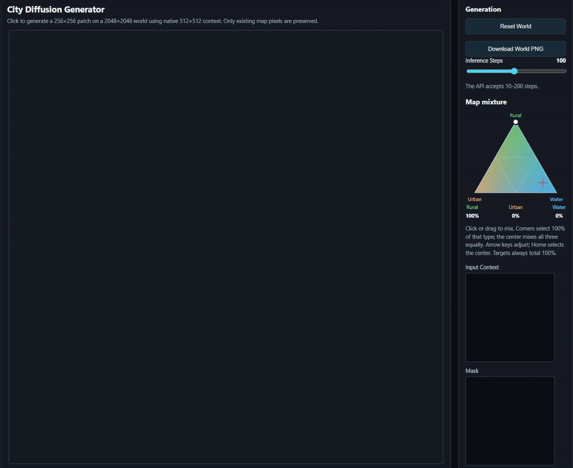
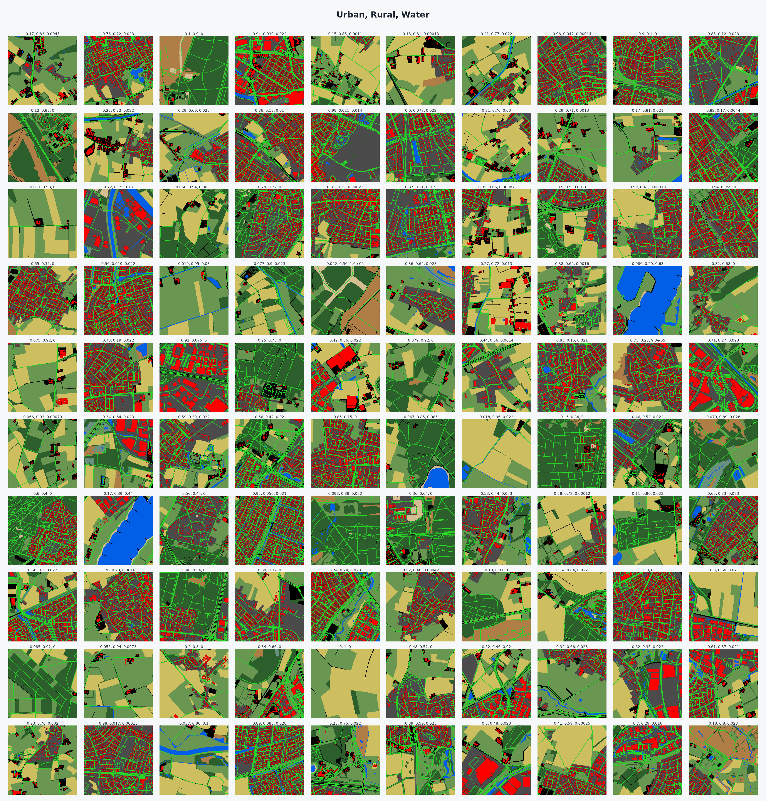

# City Diffusion 2

CityDiffusion2 is a diffusion model trained to generate stylized city maps, one patch at a time. This is the second (and much better) version of [CityDiffusion](https://github.com/bart1259/CityDiffusion). Find the model on [Hugging Face](https://huggingface.co/bart1259/CityDiffusion2).

The model works directly in 512×512 RGB pixel space with a six-level U-Net (64, 96, 128, 256, 384, and 512 channels; two residual layers per level). It predicts RGB velocity from 11 input channels: noisy RGB, a preserve/generate mask, masked RGB context, and spatially broadcast rural, urban, water, and condition-present values. DDIM sampling iteratively generates the image while keeping known context pixels intact.

## Sped up demo of editor tool



## Training data sample



Map data © [OpenStreetMap contributors](https://www.openstreetmap.org/copyright). The training tiles are derived from OpenStreetMap data, available under the [Open Database License (ODbL)](https://opendatacommons.org/licenses/odbl/).

The source code in this repository is MIT licensed; see [LICENSE](LICENSE). Data and model weights retain their respective licenses.

## Run the editor

Requires Python 3.12 and an NVIDIA GPU with a current CUDA-capable driver. Install [uv](https://docs.astral.sh/uv/getting-started/installation/), then run from this folder:

```sh
uv sync
uv run app.py --host 127.0.0.1 --port 8000
```

Open http://localhost:8000. On first start, the app downloads the model from Hugging Face. Check `uv run python -c "import torch; print(torch.cuda.is_available())"` if CUDA is not detected.

## Shared setup

Run this setup once, then choose either example below. `mask=1` preserves context; `mask=0` generates pixels. Conditions are ordered rural, urban, water, and condition-present.

```python
import numpy as np
import torch
from PIL import Image
from diffusers import DDIMScheduler, DDPMScheduler, UNet2DModel

repo = "bart1259/CityDiffusion2"
device = "cuda"
model = UNet2DModel.from_pretrained(repo, subfolder="unet_ema").to(device).eval()
train_scheduler = DDPMScheduler.from_pretrained(repo, subfolder="scheduler")
sampler = DDIMScheduler.from_config(
    train_scheduler.config,
    prediction_type="v_prediction",
    timestep_spacing="trailing",
    clip_sample=True,
    clip_sample_range=1.0,
)

def generate(context, mask, condition, seed=42, steps=100, source_rgb=None):
    condition_maps = condition[:, :, None, None].expand(-1, -1, 512, 512)
    sampler.set_timesteps(steps, device=device)
    generator = torch.Generator(device=device).manual_seed(seed)
    image = torch.randn(context.shape, generator=generator, device=device)
    known_noise = torch.randn(context.shape, generator=generator, device=device)

    with torch.inference_mode():
        for timestep in sampler.timesteps:
            t = timestep.reshape(1).long()
            noisy_known = sampler.add_noise(context, known_noise, t)
            image = mask * noisy_known + (1 - mask) * image
            model_input = torch.cat([image, mask, context * mask, condition_maps], dim=1)
            velocity = model(model_input, t).sample
            image = sampler.step(
                velocity, timestep, image, eta=0.0, use_clipped_model_output=True
            ).prev_sample

    pixels = image[0].add(1).div(2).clamp(0, 1).mul(255).byte().permute(1, 2, 0).cpu().numpy()
    if source_rgb is not None:
        preserve = mask[0, 0].byte().cpu().numpy().astype(bool)
        pixels[preserve] = source_rgb[preserve]
    return Image.fromarray(pixels)
```

## Unconditional generation

No context pixels or metadata are supplied. A zero condition-present channel tells the model to ignore metadata.

```python
context = torch.zeros((1, 3, 512, 512), device=device)
mask = torch.zeros((1, 1, 512, 512), device=device)
condition = torch.zeros((1, 4), device=device)

generate(context, mask, condition).save("unconditional.png")
```

## Conditioned generation

This example uses 70% rural, 20% urban, and 10% water, preserving the top-left 128×128 context tile.

```python
source_rgb = np.asarray(
    Image.open("context.png").convert("RGB").resize((512, 512), Image.Resampling.NEAREST)
)
context = torch.from_numpy(source_rgb.copy()).permute(2, 0, 1)[None].to(device).float() / 127.5 - 1
mask = torch.zeros((1, 1, 512, 512), device=device)
mask[:, :, :128, :128] = 1
condition = torch.tensor([[0.7, 0.2, 0.1, 1.0]], device=device)

generate(context, mask, condition, source_rgb=source_rgb).save("conditioned.png")
```

## Training pipeline

Run these stages in order. The OSM data and generated tile dataset are not included.

1. **`training/01_pbf_to_geopandas.ipynb`** — Reads an OSM PBF, extracts configured map features and administrative boundaries, and writes a projected GeoParquet cache. It uses `training/config.py` for feature queries, colors, tags, and geometry processing. You can get OSM PBFs from [Geofabrik](https://download.geofabrik.de/europe/netherlands.html).
2. **`training/02_mill_tiles.py`** — Rasterizes the cache into 512×512 map tiles and writes coverage metadata for rural, urban, and water conditions. Pregenerated images and metadata are available on [Hugging Face](https://huggingface.co/datasets/bart1259/netherlands_512_2m).
3. **`training/03_train_maps_pixel.py`** — Trains the conditional pixel-space diffusion model, including masked-context inpainting, velocity prediction, and EMA weights.

Usually trains within 20 hours on 8 v100s.

The notebook expects `pyrosm`, GeoPandas, and its configuration in `training/`. The tile renderer consumes the cache manifest it creates. The trainer consumes the rendered PNG dataset and its metadata CSV.
